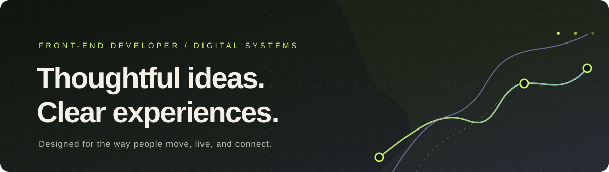

  

<h1 align="center">Front-end developer, building with intention</h1>

  Front-end developer&nbsp; · &nbsp;Responsive web experiences&nbsp; · &nbsp;Digital systems

  <a href="https://bulshaawi42.github.io/my-profolio/">PORTFOLIO ↗</a>
  &nbsp; · &nbsp;
  <a href="mailto:maxamedyaxyeiid99@gmail.com">EMAIL ME ↗</a>

---

### A little about me

I’m a front-end developer who enjoys turning useful ideas into clear, responsive experiences. I care about thoughtful layouts, accessible interactions, and the small details that make software feel easy to use.

### Product areas I enjoy

| Mobility | Property | Everyday living |
|:--|:--|:--|
| Transportation and journey-planning experiences | Real estate browsing and property information | Apartment and resident-service experiences |

These are the kinds of systems I’m interested in designing and building. See my portfolio for the current showcase.

### Toolbelt

`HTML` &nbsp; `CSS` &nbsp; `JavaScript` &nbsp; `GitHub Pages`

### Around GitHub

I’m part of [SomDev-Team](https://github.com/SomDev-Team) and [PHP-Innovators](https://github.com/PHP-Innovators).

---

  Have a project in mind? <a href="mailto:maxamedyaxyeiid99@gmail.com">Let’s talk</a>.

