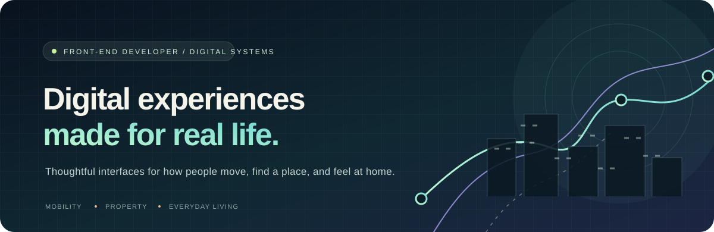

  

<h1 align="center">Maxamed-Bulshaawi</h1>

FRONT-END DEVELOPER &nbsp;·&nbsp; RESPONSIVE WEB &nbsp;·&nbsp; DIGITAL SYSTEMS

  <a href="https://bulshaawi42.github.io/portfolio/"><strong>VISIT MY PORTFOLIO ↗</strong></a>
  &nbsp;&nbsp; · &nbsp;&nbsp;
  <a href="mailto:maxamedyaxyeiid99@gmail.com"><strong>CONTACT ME ↗</strong></a>

 

## Thoughtful design. Useful technology.

I’m a front-end developer focused on building clear, responsive experiences. I enjoy bringing a considered visual style to useful systems and making complex tasks feel simple.

## Areas I build for

<table>
  <tr>
    <td width="33%" valign="top">
      <strong>01 &nbsp; Mobility</strong>  
      Transportation and journey-planning experiences that help people move with confidence.
    </td>
    <td width="33%" valign="top">
      <strong>02 &nbsp; Property</strong>  
      Real estate browsing and property information, organized to make decisions easier.
    </td>
    <td width="33%" valign="top">
      <strong>03 &nbsp; Everyday living</strong>  
      Apartment and resident-service experiences that bring daily tasks into one place.
    </td>
  </tr>
</table>

<a href="https://bulshaawi42.github.io/portfolio/#systems">Explore the systems showcase ↗</a>

## My toolkit

`HTML` &nbsp; `CSS` &nbsp; `JavaScript` &nbsp; `GitHub Pages`

## Find me

- **Portfolio:** [bulshaawi42.github.io/portfolio](https://bulshaawi42.github.io/portfolio/)
- **Email:** [maxamedyaxyeiid99@gmail.com](mailto:maxamedyaxyeiid99@gmail.com)
- **GitHub communities:** [SomDev-Team](https://github.com/SomDev-Team) · [PHP-Innovators](https://github.com/PHP-Innovators)

 

Designed with intention · Built for people

